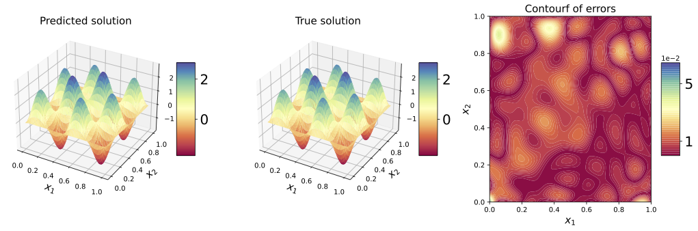

# Solving Partial Differential Equations with Random Features

This github repository contains the numerical implementations accompanying the paper **Solving Partial Differential Equations with Random Features**. It includes the code used to generate the numerical results reported in the paper.

by Chunyang Liao published in Communications in Nonlinear Science and Numerical Simulation, 2026, [[DOI]](https://www.sciencedirect.com/science/article/abs/pii/S100757042500752X?via%3Dihub).

Implementation and numerical experiments for random feature models for approximating Koopman Eigenfunctions. 

## Overview
This repository contains the numerical implementations accompanying the paper **On the Approximation of Koopman Eigenfunctions using Random Features**. The numerical experiments evaluate the performance of proposed method on several dynamical systems and provide numerical verification of theory. 

## Publication
A detailed description of the model, methodology, and numerical results is available in the following publication:

- Title: **Solving Partial Differential Equations with Random Features**
- Author: Chunyang Liao
- Journal: *Communications in Nonlinear Science and Numerical Simulation*, 152, 2026.
- Doi: [doi.org/10.1016/j.cnsns.2025.109343](https://doi.org/10.1016/j.cnsns.2025.109343)


#### Citation
```bibtex
@article{LIAO2026RF,
title = {Solving partial differential equations with random feature models},
author = {Chunyang Liao},
journal = {Communications in Nonlinear Science and Numerical Simulation},
volume = {152},
pages = {109343},
year = {2026},
issn = {1007-5704},
doi = {https://doi.org/10.1016/j.cnsns.2025.109343},
url = {https://www.sciencedirect.com/science/article/pii/S100757042500752X}
}
```

## Numerical Experiments

Contains numerical experiments for several dynamical systems, including:

- [`Advection_Diffusion/`](./Advection_Diffusion/) — Advection Diffusion Equation
- [`Allen_Cahn/`](./Allen_Cahn/) — Allen-Cahn Equation
- [`Nonlinear_PDE/`](./Nonlinear_PDE/) — Nonlinear PDE
- [`Nonlinear_Poisson/`](./Nonlinear_Poisson/) - Nonlinear Poisson

#### Nonlinear PDE

<p align="center">
  
</p>

## Environment

The experiments were developed and tested with:

- Python 3.x
- NumPy
- SciPy
